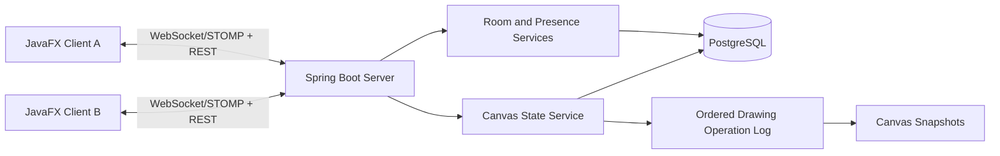

# Codex Implementation Specification
# Collaborative Canvas — Complete End-to-End Desktop Application

**Document version:** 3.0  
**Status:** Authoritative build specification for OpenAI Codex  
**Product type:** Desktop application with a shared backend  
**Development model:** One developer; Codex is expected to implement, integrate, test, and document the complete application
**Recommended filename:** `AGENTS.md` in the repository root  
**Primary platforms:** Windows first; cross-platform Java support where dependencies permit

---

## 0. Instructions for Codex

This document is the source of truth. Your task is to **implement the complete working application**, including the JavaFX frontend, Spring Boot backend, shared contracts, PostgreSQL persistence, real-time collaboration, late-join synchronization, tests, local development setup, and documentation. Do not stop after planning or after creating a skeleton.

### Required execution behavior

1. Start by inspecting the current working directory, Git status, and existing repository files. Preserve useful existing work. Do not overwrite or delete user files without understanding them.
2. Read this entire specification before making architectural decisions.
3. Create a concise implementation plan, then execute it. The plan is not the deliverable; the working application is.
4. Implement the complete application in logical stages, but **continue through every stage without waiting for the user to approve each stage**, unless blocked by missing credentials, unavailable tools, a destructive action, or a decision that genuinely requires user input.
5. After each stage, run the relevant build and tests, fix failures, and continue. Do not leave the repository as a partial scaffold merely because one milestone is complete.
6. If a command fails, inspect the failure, fix the cause, and retry. Do not hide failures or claim tests passed without checking the actual output.
7. Use the exact module boundaries, names, data contracts, database semantics, and destinations in this document. If a genuine technical conflict requires a change, document the reason and update all affected code, tests, and documentation consistently.
8. Implement both client and server. A UI mockup alone, backend-only API, fake data, in-memory-only persistence, or disconnected demo is not completion.
9. Implement the UI directly from Section 3. The production frontend must be JavaFX/FXML/CSS; do not create a React web frontend.
10. Make reasonable, documented decisions without asking the user about every small implementation detail.
11. Do not introduce paid APIs or services as a requirement. Local development must work using Java, Gradle, and Docker Compose for PostgreSQL, or clearly documented locally installed PostgreSQL.
12. Do not commit credentials, real `.env` files, tokens, or private keys.
13. Do not implement out-of-scope features until the required MVP is complete.
14. Do not report completion until the acceptance criteria have been checked. If any criteria cannot be verified in the current environment, state precisely which and why.

### Codex operating rules

- Treat this file as the project-level source of truth. If it is named `AGENTS.md` and placed in the repository root, follow it throughout the task. If it is supplied under another filename, read it completely before editing and keep its requirements in scope.
- Use the available terminal and repository tools to inspect, edit, build, and test the project. Prefer small, coherent changes that can be verified immediately.
- Before editing, report a short plan in the working notes, then start implementation. Do not return only a plan, architecture proposal, or code snippets when you can edit the repository directly.
- Inspect `git status` first. Never discard, reset, overwrite, or delete existing user work simply to make the repository match this specification. If a change may destroy user data, stop and ask first.
- Do not ask for approval for routine implementation choices that this document already resolves. Ask only when blocked by missing credentials, a destructive action, or an irreducible product decision.
- Do not claim a command, test, build, database migration, or manual workflow succeeded unless you actually ran it and observed the result. Distinguish verified results from unverified assumptions.
- If execution time or environment limits prevent completing everything in one run, leave the repository in the most functional, buildable state possible; document the exact remaining tasks and continue in the next run rather than pretending the project is finished.
- Use the repository's existing conventions where compatible. If a required architecture change is needed, explain it briefly and update implementation, tests, and docs together.
- Do not commit or expose secrets. Provide `.env.example` or equivalent safe templates, not real credentials.

### Expected final deliverable

A complete repository that contains:
- A runnable JavaFX desktop client.
- A runnable Spring Boot backend.
- Shared DTOs and protocol constants used by both sides.
- PostgreSQL schema migrations and local database setup.
- Working room creation and joining.
- Real-time drawing, brush/color/size, eraser, clear-canvas, and presence.
- Database-backed drawing operations and versioned canvas snapshots.
- Correct late-join and reconnect synchronization.
- Automated unit, integration, and end-to-end tests where feasible.
- A clear README with exact Windows and cross-platform commands.
- Architecture, API, WebSocket protocol, database, and troubleshooting documentation.
- No fake functionality presented as complete.

### Tool-specific guidance

- **Codex:** Work directly in the repository. Inspect before editing, implement all modules, run commands and tests, fix failures, and continue until the acceptance criteria are met or a concrete blocker is reached. Use the repository root `AGENTS.md` as the persistent instruction source.
- **UI design:** Implement the screen, state, layout, and accessibility requirements in Section 3 directly in JavaFX/FXML/CSS. Do not create a React or browser-based replacement.

---

# 1. Product overview

Collaborative Canvas is a desktop drawing application that lets multiple people draw on one shared canvas in real time. Each person runs a JavaFX client. All clients connect to the same Spring Boot server. The server manages rooms, validates and orders drawing operations, persists canvas changes to PostgreSQL, and broadcasts updates to participants in the relevant room.

A participant can create a room and share its room ID. Another participant can join using that ID and immediately see the current canvas, including work completed before they joined.

The application demonstrates desktop UI engineering, real-time communication, shared state, persistence, REST APIs, WebSocket messaging, concurrency handling, testing, and deployment.

## 1.1 Product goal

Build a complete, maintainable, demonstrable application with:

- A usable JavaFX desktop interface.
- Room creation and joining.
- Real-time multi-user drawing.
- Brush, color, size, and eraser controls.
- Shared room participant list and connection status.
- Canvas state persistence in PostgreSQL.
- Late-join canvas synchronization.
- Canvas recovery after server restart.
- Input validation, clear error messages, automated tests, and documented setup.

## 1.2 MVP scope

### In scope

- Display name entry.
- Configurable server URL.
- Create room and join room by ID.
- One shared drawing canvas per room.
- Freehand drawing.
- Brush color and size.
- Eraser.
- Clear canvas.
- Real-time synchronization.
- Participant presence list.
- Late-join synchronization.
- Persisted drawing history and canvas snapshots.
- Reconnection behavior with a state resynchronization path.
- Room expiry/cleanup policy.
- Local development with PostgreSQL.
- Gradle build, automated tests, and setup documentation.

### Not in MVP

- User accounts, password-based authentication, or social login.
- Private rooms or role-based room permissions.
- Voice/video calling.
- Text chat.
- Shapes, text boxes, layers, image uploads, or imported backgrounds.
- Undo/redo across all participants.
- Export to PNG/PDF.
- Version-history UI.
- Mobile clients.
- End-to-end encryption.
- Redis clustering or multi-server horizontal scaling.
- Paid subscriptions or billing.

Do not implement out-of-scope features until the MVP is complete and tested.

---

# 2. Users and principal flows

## 2.1 User roles

The MVP has no permanent user accounts. A person enters a display name for a session. The server assigns a `participantId` for that connection/session.

- **Room creator:** creates a room and receives a room ID. The creator has no additional drawing privileges in the MVP.
- **Participant:** joins a room by ID and can draw.
- **Server:** validates operations, assigns sequence numbers, maintains canonical state, and persists it.

Do not treat a client-supplied participant ID as proof of identity. Associate each active WebSocket session with its server-side participant identity.

## 2.2 Create-room flow

1. Launch the desktop app.
2. Enter a display name.
3. Confirm the configured server URL.
4. Select **Create Room**.
5. Client calls the REST room-creation endpoint.
6. Server creates a room and persistent canvas record and returns a room ID.
7. Client establishes/subscribes to the room's STOMP destinations.
8. Client receives the initial canvas snapshot and participant list.
9. Client opens the drawing workspace.
10. Creator shares the room ID out of band.

## 2.3 Join-room flow

1. Launch the desktop app.
2. Enter a display name and server URL.
3. Enter the room ID.
4. Select **Join Room**.
5. Client requests room metadata and joins the room through the documented REST/WebSocket flow.
6. Client subscribes to room update destinations before relying on live updates.
7. Server associates the WebSocket session with the room and participant.
8. Server sends the canonical canvas snapshot and any operations required to bring it up to the current sequence number.
9. Client renders the received state, then applies newer live operations in sequence order.
10. Client displays the current participant list.

**Late-join requirement:** The joiner must see the canvas as it exists at join time, not a blank canvas. This must work when the room has been active for any length of time, subject to the room's configured lifetime and retention policy.

## 2.4 Leave/reconnect flow

- A participant can leave the room and return to the home screen.
- A WebSocket disconnect marks the participant offline and removes them from the active participant list after server-side disconnect handling.
- A reconnect must rejoin/resubscribe and resynchronize canvas state from the server.
- If the room no longer exists or has expired, show a clear message and return to the home screen.
- Network failures must not crash the JavaFX application.

---

# 3. UI/UX requirements

## 3.1 Visual direction

Design a clean, modern desktop collaboration tool. Prefer a neutral light theme with high contrast, a subtle accent color, clear spacing, and restrained decoration. The drawing area should dominate the workspace. Controls should be easy to discover without covering the canvas.

Create a coherent design system with reusable values for colors, typography, spacing, corner radius, borders, focus states, disabled states, and error/success messages.

Implement the following screens and states directly in JavaFX. These requirements describe the production desktop interface, not a browser-based application.

## 3.2 Screen A — Home / Connect

Required elements:

- Product name: **Collaborative Canvas**.
- Display-name field (`displayName`).
- Server URL field (`serverUrl`), prefilled from application configuration.
- **Create Room** button.
- Room ID field (`roomId`) and **Join Room** button.
- Connection/error message area.
- A small server connection status indicator.
- Input validation messages.

Behavior:

- Disable room actions while a request is in progress.
- Reject an empty display name.
- Trim whitespace from the display name and room ID.
- Show a useful error if the server URL is invalid or unreachable.
- Do not show a fake success state before the server confirms the action.

## 3.3 Screen B — Drawing workspace

Required layout:

1. **Top bar**
   - Product icon/name.
   - Room ID with a **Copy ID** button.
   - Connection state: Connecting, Connected, Reconnecting, or Disconnected.
   - **Leave Room** button.

2. **Left/tool panel**
   - Brush tool.
   - Eraser tool.
   - Color picker.
   - Preset colors.
   - Brush size slider and numeric display.
   - **Clear Canvas** button, with confirmation before destructive clearing.
   - Selected-tool visual state.

3. **Central canvas**
   - Large white/light drawing surface.
   - Canvas resizes with the window.
   - Drawing uses normalized coordinates so remote drawings remain aligned across differently sized windows.
   - Canvas must not stretch or distort aspect ratio unexpectedly.
   - Remote operations render on the same canvas as local operations.
   - Show a loading indicator while the initial canvas state is being received.
   - Do not present a blank canvas as ready before initial synchronization completes.

4. **Participants panel**
   - Heading: **People in room**.
   - Display name for each active participant.
   - A visual indicator for the current user.
   - Participant count.
   - Join/leave status messages may appear as small, non-blocking notifications.

5. **Error/status area**
   - Connection loss/reconnect message.
   - Canvas synchronization error.
   - Room expired/not found message.
   - Avoid modal alerts for routine connection transitions.

## 3.4 Required UI states

Design and implement:

- Home, idle.
- Creating room.
- Joining room.
- Connecting.
- Loading/synchronizing canvas.
- Connected workspace.
- Reconnecting.
- Disconnected.
- Invalid room ID.
- Server unavailable.
- Empty canvas.
- Canvas with existing drawing.
- Room with multiple participants.
- Clear-canvas confirmation.
- Room expired.
- Unexpected server error.

## 3.5 Accessibility and usability

- Use readable text and high-contrast controls.
- All buttons have visible labels or accessible names.
- Keyboard focus is visible.
- The UI must not rely on color alone to communicate connection status.
- Sliders show their current numeric value.
- Window resizing must not hide core controls.
- The application must show actionable error messages instead of raw stack traces.

## 3.6 Implementation guidance for Codex

Implement the Home/Connect screen and Drawing Workspace described above as native JavaFX screens. The canvas must remain the primary focus of the workspace. Include all required loading, connected, reconnecting, error, and clear-confirmation states. Use consistent spacing, typography, control dimensions, and colors through JavaFX CSS and reusable style classes. Do not add unrelated features or show the workspace as ready until initial canvas synchronization has completed.

---

# 4. Architecture and technology stack

## 4.1 Required stack

### Desktop client

- Java 21 LTS.
- JavaFX compatible with the selected Java version.
- FXML for structured screens where practical.
- JavaFX CSS for styling.
- JavaFX `Canvas` and `GraphicsContext` for drawing.
- Jackson for JSON.
- A maintained STOMP/WebSocket client library compatible with Java 21.
- Gradle.
- JUnit 5 for tests.

Choose and document one compatible STOMP client library during project setup. Keep it behind a client-side interface so the library can be changed without rewriting UI controllers.

### Backend

- Java 21 LTS.
- Spring Boot 3.x line compatible with Java 21 (pin a specific supported patch release at setup time).
- Spring Web.
- Spring WebSocket with STOMP messaging.
- Spring Data JPA.
- Hibernate.
- PostgreSQL JDBC driver.
- Jackson.
- Bean Validation.
- Flyway database migrations.
- Spring Boot Actuator for health checks.
- JUnit 5 and Spring Boot Test.

### Database

- PostgreSQL.
- Persistent room metadata, canvas snapshots, and drawing operation log.
- Flyway owns schema migrations.
- Do not use an in-memory database as the persistence solution. H2 may be used in isolated unit tests only if integration tests also cover PostgreSQL behavior.

### Build and repository

- Gradle multi-project build.
- Git/GitHub.
- One root Gradle build with `client`, `server`, and `shared` modules.
- Do not duplicate shared DTOs in the client and server.

## 4.2 High-level architecture



The client is responsible for drawing input and rendering. The server is responsible for validating operations, assigning ordering, managing participants, and maintaining the canonical shared state. PostgreSQL persists the state so it survives late joins and server restarts.

## 4.3 Server is authoritative

- Clients send drawing intent/operations; they do not directly write to PostgreSQL.
- Server validates `roomId`, sender session membership, operation type, coordinates, brush size, and payload size.
- Server assigns a monotonically increasing `sequenceNumber` per room to accepted canvas-changing operations.
- Server persists each accepted canvas-changing operation before acknowledging/broadcasting it as committed.
- Server applies operations in sequence order to its canonical canvas state.
- Clients apply committed operations in sequence order.
- Presence and cursor updates are transient and do not need to be persisted.
- Do not allow clients to claim another participant's `participantId`.

## 4.4 State synchronization algorithm

This algorithm is mandatory.

1. Every room has a current `lastSequenceNumber`.
2. Each persisted canvas-changing operation has a unique, monotonically increasing `sequenceNumber` within its room.
3. The database stores a canonical snapshot with `snapshotSequenceNumber`.
4. When a client joins, the server obtains a consistent synchronization point at sequence `S`.
5. The server loads the latest snapshot for the room with `snapshotSequenceNumber <= S`.
6. The server loads all committed canvas operations after that snapshot and up to `S`.
7. The server sends `CANVAS_STATE` containing the snapshot and replay operations, or a compacted canvas document equivalent that reconstructs the same state, with `lastSequenceNumber = S`.
8. The client renders the synchronized state and sets `lastAppliedSequenceNumber = S`.
9. Operations with sequence numbers greater than `S` are delivered as live updates. If messages arrive out of order, the client buffers them until the next expected sequence is available or requests resynchronization.
10. The server must avoid a race between snapshot/replay and live updates. Use a per-room sequencing/locking strategy or a subscribe-then-buffer synchronization flow. Document and test the selected strategy.
11. If a gap is detected or the client reconnects, it can request a full resynchronization.

Do not merely broadcast the current in-memory canvas or send only new operations to late joiners.

## 4.5 Snapshot strategy

- Store a snapshot on room creation (empty canvas, sequence 0).
- Store a new snapshot after every 100 accepted canvas-changing operations or after 30 seconds with new changes, whichever comes first.
- Snapshot creation must be consistent with the operation sequence it records.
- Keep the latest snapshot and a configurable number of older snapshots (default 3) for recovery/debugging.
- Do not delete operation-log records needed to replay from the retained snapshot. If log compaction is implemented, do so only after a newer snapshot is successfully committed and ensure late-join reconstruction remains correct.
- A snapshot contains a versioned serialized `CanvasDocument`.
- Use JSONB for the snapshot document and operation payloads.
- Snapshot failure must not silently corrupt canvas state. Log the failure, expose health/diagnostic information, and allow a later retry.

---

# 5. Repository structure and Java package names

Use this multi-project layout. Keep names consistent.

```text
collaborative-canvas/
├── settings.gradle
├── build.gradle
├── gradle.properties
├── gradlew
├── gradlew.bat
├── PRD.md
├── README.md
├── .gitignore
├── .env.example
├── docker-compose.yml
├── client/
│   ├── build.gradle
│   └── src/
│       ├── main/java/com/collaborativecanvas/client/
│       │   ├── CollaborativeCanvasClient.java
│       │   ├── config/
│       │   │   ├── ClientConfig.java
│       │   │   └── ClientConfigLoader.java
│       │   ├── controller/
│       │   │   ├── HomeController.java
│       │   │   └── CanvasController.java
│       │   ├── drawing/
│       │   │   ├── CanvasRenderer.java
│       │   │   ├── DrawingInputHandler.java
│       │   │   ├── CoordinateMapper.java
│       │   │   └── CanvasDocument.java
│       │   ├── model/
│       │   │   ├── ClientSession.java
│       │   │   ├── ParticipantViewModel.java
│       │   │   └── ConnectionStatus.java
│       │   ├── service/
│       │   │   ├── RoomApiClient.java
│       │   │   ├── CanvasSyncService.java
│       │   │   └── UiNotificationService.java
│       │   ├── websocket/
│       │   │   ├── StompClient.java
│       │   │   ├── StompEventListener.java
│       │   │   └── ReconnectManager.java
│       │   └── util/
│       │       └── FxThread.java
│       ├── main/resources/
│       │   ├── fxml/
│       │   │   ├── home-view.fxml
│       │   │   └── canvas-view.fxml
│       │   ├── styles/
│       │   │   └── app.css
│       │   └── application.properties
│       └── test/java/com/collaborativecanvas/client/
│           ├── drawing/
│           ├── service/
│           └── websocket/
├── server/
│   ├── build.gradle
│   └── src/
│       ├── main/java/com/collaborativecanvas/server/
│       │   ├── ServerApplication.java
│       │   ├── config/
│       │   │   ├── WebSocketConfig.java
│       │   │   ├── CorsConfig.java
│       │   │   └── PersistenceConfig.java
│       │   ├── controller/
│       │   │   ├── RoomRestController.java
│       │   │   └── HealthRestController.java
│       │   ├── websocket/
│       │   │   ├── CanvasMessageController.java
│       │   │   └── WebSocketSessionListener.java
│       │   ├── service/
│       │   │   ├── RoomService.java
│       │   │   ├── ParticipantService.java
│       │   │   ├── CanvasStateService.java
│       │   │   ├── DrawingOperationService.java
│       │   │   ├── CanvasSnapshotService.java
│       │   │   └── RoomCleanupService.java
│       │   ├── repository/
│       │   │   ├── RoomRepository.java
│       │   │   ├── CanvasSnapshotRepository.java
│       │   │   └── DrawingOperationRepository.java
│       │   ├── entity/
│       │   │   ├── RoomEntity.java
│       │   │   ├── CanvasSnapshotEntity.java
│       │   │   └── DrawingOperationEntity.java
│       │   ├── model/
│       │   │   ├── RoomState.java
│       │   │   └── ParticipantSession.java
│       │   ├── mapper/
│       │   │   └── CanvasStateMapper.java
│       │   └── exception/
│       │       ├── GlobalExceptionHandler.java
│       │       ├── RoomNotFoundException.java
│       │       └── InvalidDrawingOperationException.java
│       ├── main/resources/
│       │   ├── application.yml
│       │   └── db/migration/
│       │       ├── V1__create_rooms.sql
│       │       ├── V2__create_canvas_snapshots.sql
│       │       └── V3__create_drawing_operations.sql
│       └── test/java/com/collaborativecanvas/server/
│           ├── service/
│           ├── controller/
│           ├── websocket/
│           └── integration/
├── shared/
│   ├── build.gradle
│   └── src/
│       ├── main/java/com/collaborativecanvas/shared/
│       │   ├── dto/
│       │   │   ├── CreateRoomResponse.java
│       │   │   ├── RoomDetailsResponse.java
│       │   │   ├── JoinRoomRequest.java
│       │   │   ├── DrawingOperationMessage.java
│       │   │   ├── CanvasStateMessage.java
│       │   │   ├── CanvasSnapshotDto.java
│       │   │   ├── ParticipantDto.java
│       │   │   ├── ErrorMessage.java
│       │   │   └── ClearCanvasRequest.java
│       │   ├── enums/
│       │   │   ├── DrawingOperationType.java
│       │   │   └── ServerEventType.java
│       │   └── protocol/
│       │       ├── ApiPaths.java
│       │       └── WebSocketDestinations.java
│       └── test/java/com/collaborativecanvas/shared/
├── docs/
│   ├── architecture.md
│   ├── api.md
│   ├── websocket-protocol.md
│   ├── database.md
│   └── runbook.md
└── scripts/
    ├── dev-start.md
    └── dev-reset.md
```

### Package naming rule

Use `com.collaborativecanvas.client`, `com.collaborativecanvas.server`, and `com.collaborativecanvas.shared`. Do not use `com.example` in production source files.

### Module dependencies

- `shared`: shared DTOs, enums, protocol constants. No dependency on client or server modules.
- `client`: depends on `shared`; does not depend on `server`.
- `server`: depends on `shared`; does not depend on `client`.
- Root Gradle build coordinates versions and common settings.
- Use a compatible Jackson version supplied by the selected Spring Boot dependency management; do not pin conflicting Jackson versions independently without need.

---

# 6. Naming conventions and canonical data model

Use Java `camelCase` for fields and methods, `PascalCase` for classes, and `UPPER_SNAKE_CASE` for enum constants.

## 6.1 Shared identifiers and variables

| Name | Type | Meaning |
|---|---|---|
| `roomId` | `String` | Public room identifier, generated by server |
| `participantId` | `String` | Server-assigned participant/session identifier |
| `displayName` | `String` | User-visible participant name |
| `operationId` | `UUID` | Client-generated unique ID for idempotency |
| `sequenceNumber` | `long` | Server-assigned operation order within one room |
| `lastSequenceNumber` | `long` | Highest committed operation sequence for a room |
| `snapshotSequenceNumber` | `long` | Highest operation represented by a snapshot |
| `canvasWidth` | `double` | Logical canvas width used by client rendering |
| `canvasHeight` | `double` | Logical canvas height used by client rendering |
| `normalizedX` | `double` | X coordinate normalized to [0, 1] |
| `normalizedY` | `double` | Y coordinate normalized to [0, 1] |
| `colorHex` | `String` | Hex color such as `#1E88E5` |
| `brushSize` | `double` | Brush diameter in logical canvas units; bounded by server |
| `isEraser` | `boolean` | Whether the stroke uses eraser behavior |
| `createdAt` | `Instant` | Server-side creation timestamp |
| `updatedAt` | `Instant` | Server-side last-update timestamp |
| `payloadJson` | JSON/JSONB | Serialized operation data |
| `snapshotJson` | JSON/JSONB | Serialized canonical canvas document |

Do not use raw pixel coordinates tied to a particular window size as the persisted coordinate system. Use normalized coordinates to preserve alignment across clients with different window dimensions.

## 6.2 `DrawingOperationType`

Use these exact enum constants:

```java
public enum DrawingOperationType {
    DRAW_START,
    DRAW_MOVE,
    DRAW_END,
    ERASE_START,
    ERASE_MOVE,
    ERASE_END,
    CLEAR_CANVAS
}
```

Cursor movement and participant presence are not canvas-changing operations and must not be written to the persistent drawing log.

## 6.3 Canvas document format

The canonical `CanvasDocument` is a versioned representation that can be serialized to JSON and stored as a snapshot.

Required conceptual fields:

```json
{
  "schemaVersion": 1,
  "canvasWidth": 1200.0,
  "canvasHeight": 800.0,
  "strokes": [
    {
      "strokeId": "uuid",
      "participantId": "participant-uuid",
      "colorHex": "#1E88E5",
      "brushSize": 6.0,
      "isEraser": false,
      "points": [
        { "normalizedX": 0.2, "normalizedY": 0.3 },
        { "normalizedX": 0.21, "normalizedY": 0.31 }
      ]
    }
  ]
}
```

This is an illustrative data contract. Implement typed Java classes for the document, strokes, and points rather than passing unvalidated arbitrary maps throughout the application.

The server must define how `CLEAR_CANVAS` affects the document: it clears the stroke collection and becomes a sequenced, persisted operation. It must not be possible for a delayed pre-clear operation to reappear after a clear due to out-of-order processing.

For the MVP, eraser behavior should be consistent on every client. Prefer a canonical stroke/document representation with eraser strokes rendered using the same clear/compositing behavior on all clients. Document the chosen JavaFX rendering approach and test it.

---

# 7. Database requirements and schema

## 7.1 Persistence goals

PostgreSQL must preserve:

- Room metadata and lifecycle.
- A current canvas snapshot and optional older snapshots.
- An ordered log of accepted canvas-changing operations.
- The sequence number needed to reconstruct the current canvas.

The participant list represents live presence and is transient in the MVP. Do not persist disconnected sessions as if they were currently online.

## 7.2 Table: `rooms`

Required columns:

| Column | Type | Rules |
|---|---|---|
| `id` | `UUID` | Primary key |
| `room_code` | `VARCHAR(12)` | Unique, indexed, public join code |
| `status` | `VARCHAR(20)` | `ACTIVE` or `EXPIRED` |
| `last_sequence_number` | `BIGINT` | Not null, default 0 |
| `created_at` | `TIMESTAMPTZ` | Not null |
| `updated_at` | `TIMESTAMPTZ` | Not null |
| `last_activity_at` | `TIMESTAMPTZ` | Not null |
| `expires_at` | `TIMESTAMPTZ` | Not null or derived by documented policy |

Room IDs/codes must be generated on the server using a collision-resistant strategy. Retry if a unique-code collision occurs. Do not trust a room code generated by a client.

## 7.3 Table: `canvas_snapshots`

Required columns:

| Column | Type | Rules |
|---|---|---|
| `id` | `UUID` | Primary key |
| `room_id` | `UUID` | Foreign key to `rooms.id`, indexed |
| `snapshot_sequence_number` | `BIGINT` | Not null |
| `schema_version` | `INTEGER` | Not null |
| `snapshot_json` | `JSONB` | Not null |
| `created_at` | `TIMESTAMPTZ` | Not null |

A snapshot records the complete canonical canvas at `snapshot_sequence_number`. Multiple snapshots per room are permitted. Add an index on `(room_id, snapshot_sequence_number DESC)`.

## 7.4 Table: `drawing_operations`

Required columns:

| Column | Type | Rules |
|---|---|---|
| `id` | `UUID` | Primary key |
| `room_id` | `UUID` | Foreign key to `rooms.id`, indexed |
| `operation_id` | `UUID` | Client-generated idempotency ID |
| `sequence_number` | `BIGINT` | Server-assigned order |
| `participant_id` | `VARCHAR(64)` | Server-verified sender identifier |
| `operation_type` | `VARCHAR(30)` | Must match the supported enum |
| `payload_json` | `JSONB` | Not null |
| `created_at` | `TIMESTAMPTZ` | Server timestamp |

Add unique constraint `(room_id, operation_id)` for idempotency and unique constraint `(room_id, sequence_number)` for operation ordering. Add index `(room_id, sequence_number)`.

Do not persist `CURSOR_MOVE`, join, leave, or heartbeat events in this table.

## 7.5 Operation durability and transaction rules

For each canvas-changing operation:

1. Validate the WebSocket session and room membership.
2. Validate payload size, operation type, normalized coordinates, color, and brush size.
3. Check whether `(roomId, operationId)` has already been accepted. If yes, return/emit the prior result rather than applying it twice.
4. Assign the next sequence number atomically for that room.
5. Persist the operation and update the room's sequence/activity metadata transactionally.
6. Update canonical in-memory room state only in a way consistent with the committed database operation.
7. Broadcast the accepted operation with its `sequenceNumber`.
8. Trigger snapshot creation according to the snapshot policy.

If persistence fails, do not broadcast the operation as committed. Return a clear error and keep the canonical committed state consistent with the database. Protect per-room sequence assignment and state mutation against concurrent operations.

## 7.6 Room lifetime and cleanup

- Default inactive-room lifetime: 24 hours since last activity, configurable.
- A room with active participants must not expire.
- On expiration, mark the room expired and reject new joins.
- A scheduled cleanup task may remove expired rooms and their dependent snapshots/operations after a configurable retention grace period (default 7 days).
- Use database foreign keys and an explicit deletion policy.
- Cleanup must never delete a live room or a room that is currently being synchronized.
- Document how developers can reset local test data without accidentally running destructive cleanup in production.

## 7.7 Database migrations and configuration

- Use Flyway migrations in `server/src/main/resources/db/migration`.
- Do not rely on `spring.jpa.hibernate.ddl-auto=create` or `create-drop` for normal development/production.
- Use `validate` or a similarly safe setting with Flyway-managed schema.
- Read database connection settings from environment variables.
- Supply `.env.example` with placeholder values only; never commit a real `.env`.

Suggested variables:

```text
DB_HOST=localhost
DB_PORT=5432
DB_NAME=collaborative_canvas
DB_USERNAME=canvas_app
DB_PASSWORD=change_me_locally
SERVER_PORT=8080
ROOM_INACTIVE_TTL_HOURS=24
ROOM_RETENTION_GRACE_DAYS=7
CANVAS_SNAPSHOT_OPERATION_THRESHOLD=100
CANVAS_SNAPSHOT_INTERVAL_SECONDS=30
```

The actual application configuration must map these variables explicitly and document defaults. The password above is a placeholder, not a valid production credential.

---

# 8. REST API contract

Use JSON request and response bodies. Base path: `/api/v1`.

## 8.1 Create room

`POST /api/v1/rooms`

Request:

```json
{
  "displayName": "Alex"
}
```

Response `201 Created`:

```json
{
  "roomId": "room-public-code",
  "participantId": "server-assigned-participant-id",
  "displayName": "Alex",
  "status": "ACTIVE",
  "lastSequenceNumber": 0,
  "createdAt": "2026-01-01T10:00:00Z"
}
```

The `roomId` exposed to users is the public `room_code`. The database's internal UUID is not exposed as the join code.

## 8.2 Get room details

`GET /api/v1/rooms/{roomId}`

Response `200 OK`:

```json
{
  "roomId": "room-public-code",
  "status": "ACTIVE",
  "participantCount": 2,
  "lastSequenceNumber": 42,
  "createdAt": "2026-01-01T10:00:00Z",
  "lastActivityAt": "2026-01-01T10:10:00Z"
}
```

Do not expose private session information or database internals.

## 8.3 Health check

`GET /actuator/health`

Return Spring Boot Actuator health data. Configure exposure conservatively; do not expose environment values or secrets.

## 8.4 Error response format

All REST errors use a consistent JSON structure:

```json
{
  "code": "ROOM_NOT_FOUND",
  "message": "This room does not exist or has expired.",
  "timestamp": "2026-01-01T10:00:00Z",
  "requestId": "correlation-id"
}
```

Define a typed `ErrorMessage` DTO in `shared`. Avoid returning stack traces to clients.

Suggested error codes include:

- `INVALID_REQUEST`
- `INVALID_DISPLAY_NAME`
- `ROOM_NOT_FOUND`
- `ROOM_EXPIRED`
- `ROOM_FULL`
- `NOT_IN_ROOM`
- `INVALID_OPERATION`
- `OPERATION_TOO_LARGE`
- `CANVAS_SYNC_FAILED`
- `SERVER_UNAVAILABLE`
- `INTERNAL_ERROR`

---

# 9. WebSocket/STOMP protocol contract

## 9.1 Connection endpoint

- STOMP endpoint: `/ws`
- Application destination prefix: `/app`
- Room broadcast prefix: `/topic`
- User-specific error/ack prefix: `/user/queue`

The client must use the configured server base URL and derive the WebSocket endpoint without hardcoding a host in source code. Local example: `ws://localhost:8080/ws`. Production deployment must use secure WebSockets (`wss://`) behind TLS.

## 9.2 Destinations

| Purpose | Destination |
|---|---|
| Join room / request synchronization | `/app/rooms/{roomId}/join` |
| Leave room | `/app/rooms/{roomId}/leave` |
| Submit drawing operation | `/app/rooms/{roomId}/operations` |
| Request full canvas resync | `/app/rooms/{roomId}/sync` |
| Send transient cursor update | `/app/rooms/{roomId}/cursor` |
| Receive canvas operations/state | `/topic/rooms/{roomId}/canvas` |
| Receive participant presence | `/topic/rooms/{roomId}/participants` |
| Receive sender-specific errors/acks | `/user/queue/messages` |

Define destination strings in `WebSocketDestinations`; do not scatter hardcoded copies across controllers and services.

## 9.3 Drawing operation message

Client request example:

```json
{
  "operationId": "8e7e2a90-5b83-4e4f-a912-3c4d5e6f7a80",
  "roomId": "room-public-code",
  "type": "DRAW_START",
  "strokeId": "1a2b3c4d-5e6f-4a12-8b90-123456789abc",
  "normalizedX": 0.2,
  "normalizedY": 0.3,
  "colorHex": "#1E88E5",
  "brushSize": 6.0,
  "isEraser": false,
  "clientTimestamp": "2026-01-01T10:00:00Z"
}
```

Server-accepted/broadcast example:

```json
{
  "operationId": "8e7e2a90-5b83-4e4f-a912-3c4d5e6f7a80",
  "roomId": "room-public-code",
  "participantId": "server-assigned-participant-id",
  "type": "DRAW_START",
  "strokeId": "1a2b3c4d-5e6f-4a12-8b90-123456789abc",
  "normalizedX": 0.2,
  "normalizedY": 0.3,
  "colorHex": "#1E88E5",
  "brushSize": 6.0,
  "isEraser": false,
  "sequenceNumber": 43,
  "serverTimestamp": "2026-01-01T10:00:00Z"
}
```

Rules:

- `participantId`, `sequenceNumber`, and `serverTimestamp` are assigned/verified by the server; ignore or reject client attempts to supply trusted values.
- `operationId` must be unique per room and used for idempotency.
- `normalizedX` and `normalizedY` must be finite numbers in `[0.0, 1.0]`.
- `colorHex` must match a validated hexadecimal color format.
- `brushSize` must be within configured bounds (initial defaults: 1.0 to 50.0 logical units).
- Payload size must be bounded.
- A client must not be allowed to submit operations to a room unless its current server-side session is a member.
- The server assigns strictly increasing sequence numbers per room for accepted canvas-changing operations.

For `DRAW_MOVE` and `ERASE_MOVE`, point data may be batched to reduce message volume. If batching is used, define a typed list of points and apply the same coordinate validation to every point. Do not silently introduce a different JSON shape on one side.

## 9.4 Canvas state message

The synchronization response must contain enough information to rebuild the exact visible canvas.

Conceptual format:

```json
{
  "roomId": "room-public-code",
  "type": "CANVAS_STATE",
  "schemaVersion": 1,
  "snapshotSequenceNumber": 40,
  "lastSequenceNumber": 43,
  "snapshot": {
    "canvasWidth": 1200.0,
    "canvasHeight": 800.0,
    "strokes": []
  },
  "operationsAfterSnapshot": [
    {
      "sequenceNumber": 41,
      "type": "DRAW_START"
    },
    {
      "sequenceNumber": 42,
      "type": "DRAW_MOVE"
    },
    {
      "sequenceNumber": 43,
      "type": "DRAW_END"
    }
  ]
}
```

The abbreviated operations above illustrate the structure only. Production messages must use the full typed operation DTO. If the server sends a compacted `snapshot` that already includes operations through `lastSequenceNumber`, then `operationsAfterSnapshot` must be empty and the sequence metadata must reflect that. Never replay operations already included in the snapshot.

The client must not show the workspace as ready until it has applied the full synchronization response.

## 9.5 Presence messages

A participant presence message contains:

- `roomId`
- `eventType`: `USER_JOINED` or `USER_LEFT`
- `participantId`
- `displayName`
- `activeParticipantCount`
- `serverTimestamp`

Presence is transient. Rebuild the participant list from server-confirmed state after a reconnect.

## 9.6 Cursor messages

Cursor messages are optional for the MVP and must be transient. They must not be persisted as drawing operations. If not implemented in the first release, omit the cursor UI/control rather than leaving a nonfunctional control.

---

# 10. Concurrency, drawing, and rendering requirements

## 10.1 Coordinate mapping

- Use normalized coordinates in network messages and persisted operations.
- Convert to local canvas pixels only at render time.
- Use `CoordinateMapper` for both conversion directions.
- Handle letterboxing/maintained aspect ratio consistently.
- Ignore input outside the active drawable region.
- Resizing the window must not alter persisted point coordinates.

## 10.2 Drawing behavior

- `DRAW_START` begins a stroke.
- `DRAW_MOVE` appends points to the active stroke.
- `DRAW_END` finalizes the stroke.
- Eraser events use the same stroke lifecycle with `isEraser = true` or the agreed eraser operation types.
- `CLEAR_CANVAS` clears all visible strokes and increments the room sequence number.
- All clients render accepted operations in sequence order.
- A late joiner must receive both finalized strokes and any supported in-progress stroke state represented by the committed operation log.
- Keep drawing responsive. Batch move points when useful, but preserve ordering and prevent oversized payloads.

## 10.3 JavaFX thread safety

- Network callbacks must not mutate JavaFX controls directly.
- Use `Platform.runLater` or a small `FxThread` utility for UI changes.
- Do not perform database or blocking network calls on the JavaFX Application Thread.
- Keep network, rendering, and UI responsibilities separated.

## 10.4 Ordering and concurrency

- Use a per-room lock/serialized executor or another clearly documented strategy for applying operations and assigning sequence numbers.
- Do not assume WebSocket callbacks from multiple users are automatically serialized into a safe global order.
- A clear operation must be ordered relative to drawing operations.
- Duplicate operations must not be applied twice.
- The client should ignore already-applied sequence numbers and detect gaps.
- If a gap cannot be filled, request a full resynchronization.

---

# 11. Security, reliability, and validation

This is a project MVP, but it must follow safe engineering practices.

- Validate every incoming REST and WebSocket payload.
- Limit display-name length (for example, 1–32 characters after trimming).
- Limit room-code length and validate its allowed characters.
- Limit operation payload sizes and point counts.
- Validate numeric values against NaN/infinity and configured bounds.
- Derive participant identity from server-side session association.
- Do not trust a client-supplied room membership claim.
- Configure allowed WebSocket origins for the actual client/deployment scenario.
- Do not log credentials, tokens, or full sensitive environment settings.
- Use TLS and `wss://` for public deployment.
- Store credentials in environment variables or deployment secrets.
- Use parameterized repository/database operations; do not concatenate user input into SQL.
- Return safe, consistent error DTOs.
- Keep health endpoints from exposing secrets.
- Handle server shutdown gracefully where practical.
- Log unexpected errors with a request/correlation ID and useful context.
- Configure message size and rate limits appropriate to a drawing application.
- Document that the MVP has no user authentication and room IDs function as join secrets; do not claim it provides strong access control.

---

# 12. Non-functional requirements

| Area | Requirement |
|---|---|
| Latency | On a normal local network, accepted drawing updates should usually appear to other clients within 500 ms |
| Reliability | A dropped client must not crash the server or other clients |
| Persistence | Committed drawing operations and snapshots survive server restart |
| Late join | A joining client reconstructs the current canvas from database-backed state |
| Recovery | Reconnecting clients can request resynchronization |
| Concurrency | Concurrent operations receive a deterministic per-room order |
| UI | The interface remains responsive during network operations and synchronization |
| Maintainability | Shared DTOs and protocol constants live in the `shared` module |
| Build | The complete repository builds using Gradle |
| Testing | Unit, service, API, protocol, and PostgreSQL integration tests are provided |
| Configuration | Server URL and database settings are configurable without source edits |
| Cross-platform | Target Windows first; support macOS/Linux where selected JavaFX dependencies and packaging permit |
| Observability | Useful logs and health endpoint; never expose secrets |

---

# 13. Testing strategy

## 13.1 Shared module tests

- DTO serialization/deserialization.
- Enum values and JSON contract stability.
- Validation of representative valid and invalid payloads.

## 13.2 Backend unit tests

- Room creation and unique room codes.
- Invalid/expired room handling.
- Participant join/leave.
- Coordinate/color/brush-size validation.
- Operation idempotency.
- Per-room sequence ordering.
- Clear-canvas ordering.
- Snapshot threshold behavior.
- Cleanup behavior.

## 13.3 PostgreSQL integration tests

Use a real PostgreSQL test instance, preferably via Testcontainers if supported in the development environment, or a dedicated test database.

Test:

- Flyway migrations run from an empty database.
- Room, snapshot, and operation persistence.
- Unique constraints.
- Transaction rollback on persistence failure.
- Sequence assignment under concurrent operations.
- Snapshot load plus operation replay reconstructs the same canvas.
- Canvas state survives application restart.
- Expired-room cleanup respects retention rules.

## 13.4 WebSocket integration tests

- Client joins a valid room.
- Invalid room is rejected.
- Accepted operation is broadcast with server-assigned sequence number.
- Non-member cannot draw in a room.
- Duplicate operation is idempotent.
- Presence updates are broadcast.
- Full resynchronization returns consistent state.
- A new client joining after existing drawings receives the correct canvas.
- Operations submitted during synchronization are neither lost nor applied twice.

## 13.5 JavaFX/client tests

- Coordinate mapping round-trips.
- Renderer handles strokes and eraser strokes.
- Out-of-order/duplicate messages are buffered or ignored correctly.
- UI does not show ready state before synchronization completes.
- Disconnect/reconnect updates connection status.
- UI callbacks are marshalled to the JavaFX thread.

## 13.6 End-to-end acceptance tests

1. Start PostgreSQL and the Spring Boot server.
2. Launch two desktop clients configured to the same server.
3. Client A creates a room.
4. Client A draws several strokes.
5. Client B joins the same room later.
6. Client B sees the existing strokes.
7. Client B draws another stroke; Client A sees it.
8. Client A clears the canvas; Client B sees the clear in the correct order.
9. Draw again, stop and restart the server, and reconnect both clients.
10. Verify that the committed canvas is restored.
11. Disconnect one client and verify the other continues working.
12. Try an invalid room ID and verify a clear error message.

---

# 14. Acceptance criteria

The MVP is complete only when all of the following are true:

- [ ] The project builds using the documented Gradle command.
- [ ] PostgreSQL starts with the documented development configuration.
- [ ] Flyway creates the schema from a clean database.
- [ ] A user can enter a display name and create a room.
- [ ] The server generates a unique room code.
- [ ] A second client can join using that room code and the same server.
- [ ] Both clients display server-confirmed participant presence.
- [ ] Drawing from either client appears on the other client.
- [ ] Brush color and size work.
- [ ] Eraser behavior is consistent across clients.
- [ ] Clear Canvas is confirmed and synchronized to all participants.
- [ ] Canvas-changing operations receive server-assigned sequence numbers.
- [ ] Duplicate operations do not create duplicate strokes.
- [ ] Every committed canvas-changing operation is persisted.
- [ ] Periodic snapshots are persisted and versioned.
- [ ] A client joining mid-session receives the current canvas, not a blank canvas.
- [ ] A reconnecting client can resynchronize without losing committed work.
- [ ] Committed canvas state survives a backend restart.
- [ ] A client cannot draw in a room to which its server session does not belong.
- [ ] Invalid input and server/network errors produce clear messages.
- [ ] Tests cover persistence, ordering, synchronization, and late joins.
- [ ] The README documents setup, configuration, run commands, tests, troubleshooting, and limitations.
- [ ] No production secrets are committed.

---

# 15. Build, run, and configuration expectations

Document exact commands in the README after the Gradle project is created. Expected command patterns:

```bash
# Run tests for all modules
./gradlew test

# Build all modules
./gradlew build

# Run the Spring Boot server (adjust task name to the configured module)
./gradlew :server:bootRun

# Run the JavaFX client (adjust task name to the configured module)
./gradlew :client:run
```

Windows users should be able to use `gradlew.bat` equivalents.

Provide a `docker-compose.yml` for local PostgreSQL development. The desktop client should have a documented setting/property for the server base URL, with `http://localhost:8080` as a local development default. Derive the WebSocket endpoint from this base URL or define a clearly documented separate property.

The server must fail with a clear startup message if required database configuration is invalid or the database cannot be reached. Do not silently fall back to an in-memory database.

---

# 16. Development plan for one developer

Build in small, verifiable milestones. Do not implement every feature at once.

## Milestone 1 — Repository and shared contracts

- Create Gradle multi-project structure.
- Configure Java 21 and dependency versions.
- Create `shared` DTOs, enums, and destination constants.
- Add JSON contract tests.
- Verify `./gradlew build`.

**Exit condition:** All modules compile and shared contract tests pass.

## Milestone 2 — Database and room REST API

- Add PostgreSQL development configuration.
- Add Flyway migrations.
- Implement room entity/repository/service.
- Implement create-room and get-room endpoints.
- Add validation and standard error DTOs.
- Add PostgreSQL integration tests.

**Exit condition:** Room creation persists across server restarts and API tests pass.

## Milestone 3 — JavaFX home screen

- Implement display name, server URL, create room, and join room controls.
- Connect home screen to REST API.
- Add loading and error states.
- Implement the specified UI design using JavaFX/FXML/CSS.

**Exit condition:** User can create a room from the desktop client.

## Milestone 4 — WebSocket connection and presence

- Configure STOMP endpoint and destinations.
- Implement the client STOMP adapter.
- Implement join/leave and server-side session membership.
- Broadcast participant lists.
- Handle disconnects and errors.

**Exit condition:** Two clients can join one room and see participant updates.

## Milestone 5 — Drawing and ordered operations

- Implement canvas renderer and coordinate mapper.
- Implement brush, color, size, and eraser.
- Validate operations on the server.
- Assign sequence numbers.
- Broadcast operations in deterministic order.
- Persist operations transactionally.

**Exit condition:** Two clients draw together and committed operations are stored in PostgreSQL.

## Milestone 6 — Snapshot and late-join synchronization

- Implement canonical `CanvasDocument`.
- Create initial and periodic snapshots.
- Implement consistent snapshot-plus-replay synchronization.
- Handle the race between synchronization and live messages.
- Implement reconnect/resync.
- Add late-join, ordering, and restart tests.

**Exit condition:** A new client sees existing work, and the canvas survives server restart.

## Milestone 7 — Clear canvas, lifecycle, and error handling

- Implement sequenced clear.
- Implement expiry and retention cleanup.
- Add robust connection status and notifications.
- Test persistence failures and invalid messages.

**Exit condition:** Destructive operations and lifecycle transitions are consistent and covered by tests.

## Milestone 8 — End-to-end verification and release preparation

- Run all tests.
- Verify two-client workflows.
- Verify database recovery and late join.
- Finalize README, architecture, API, protocol, database, and troubleshooting docs.
- Add deployment instructions and TLS notes.

**Exit condition:** Every acceptance criterion is met or a clearly documented limitation is approved.

---

# 17. Codex implementation protocol

Codex must complete all milestones in Section 16, in order, without stopping after Milestone 1 or asking for approval between ordinary development stages.

## 17.1 Initial repository inspection

- Run `pwd` (or the platform equivalent), inspect directory contents, and check `git status`.
- Identify existing languages, build files, source files, and tests.
- Preserve compatible existing work; do not replace a working repository blindly.
- If no project exists, create the structure specified in Section 5.
- Record any mismatch between the existing repository and this specification, then proceed with the least disruptive compliant plan.

## 17.2 Implement the whole system

Complete these outcomes in sequence:

1. **Build foundation:** Gradle multi-project build, `client`, `server`, and `shared`, Java 21 configuration, compatible dependency versions, shared DTOs/enums/destinations, and serialization tests.
2. **Persistence foundation:** PostgreSQL development setup, Docker Compose, Flyway migrations, JPA entities/repositories, configuration via environment variables, and database integration tests.
3. **Backend REST:** room creation/details, validation, consistent error responses, health endpoint, and room lifecycle.
4. **JavaFX client shell:** application entry point, FXML screens, CSS theme, configuration loading, home/connect screen, REST integration, and actionable error states.
5. **WebSocket/presence:** STOMP configuration and client adapter, room membership bound to server-side WebSocket sessions, join/leave events, participant lists, and disconnect handling.
6. **Drawing:** normalized coordinate mapping, brush, color, brush size, eraser, sequenced clear, canvas rendering, operation validation, per-room ordering, idempotency, and broadcasting.
7. **Durable state:** transactionally persisted operations, versioned snapshots, snapshot/replay synchronization, race-free late join, reconnect/resync, and restart recovery.
8. **Reliability/security:** validation, payload limits, safe error handling, logging, room expiry/retention, and connection status states.
9. **Verification:** unit tests, PostgreSQL integration tests, WebSocket tests, client tests where practical, and end-to-end acceptance workflows.
10. **Documentation:** setup/run/test commands for Windows and other supported platforms, configuration, architecture, API and protocol details, known limitations, and troubleshooting.

## 17.3 Definition of a complete feature

A feature is not complete merely because source files exist. For each feature:
- Connect it to the real UI, service, backend, and database as appropriate.
- Handle success, invalid input, and failure paths.
- Add or update automated tests.
- Run the relevant tests.
- Update docs or configuration examples if behavior or commands changed.

Do not use hardcoded demo data as a substitute for server/database integration. Demo data may be used only in tests or clearly marked optional development fixtures.

## 17.4 Build/test loop

Use the repository's Gradle wrapper. Run commands from the repository root where possible. At minimum, work toward passing:

```bash
./gradlew test
./gradlew build
```

On Windows, also document the equivalents:

```powershell
.\gradlew.bat test
.\gradlew.bat build
```

Run targeted module tests during development. When a failure occurs:
1. Read the full relevant error.
2. Identify the underlying cause rather than suppressing the test.
3. Fix code/configuration or correct a genuinely invalid test.
4. Rerun the failed test and then the broader suite.

If Docker or a PostgreSQL service is unavailable in the execution environment, still implement the configuration and tests; run every test that is possible, and clearly list the tests that require a database/runtime not available.

## 17.5 Manual end-to-end verification

When the environment permits, run the backend and two client instances and verify:

- Client A creates a room.
- Client A draws.
- Client B joins later and sees existing drawing.
- Client B draws and Client A sees it.
- Clear Canvas propagates in correct sequence.
- Server restart does not erase committed canvas state.
- A reconnecting client resynchronizes.
- Invalid room IDs and network failures show understandable errors.

If graphical interaction is unavailable, add automated tests that verify the same backend and synchronization behavior, and document any manual checks still needed.

## 17.6 Do not stop at scaffolding

Do not finish after creating DTOs, build files, blank screens, placeholder methods, or TODO comments for core features. Do not ask the user whether to continue after each milestone. Continue implementation until the full scope is complete or a concrete blocker prevents further work.

## 17.7 Final response required from Codex

At the end, report:
- What was implemented.
- Important files/modules created or changed.
- Exact commands to start PostgreSQL, backend, and frontend.
- Exact tests/build commands run and their real results.
- Any acceptance criteria not verified.
- Known limitations and the next most important fixes.

Do not claim the application is complete if core features are placeholders or if late-join persistence has not been implemented.

---

# 18. Final product definition

Collaborative Canvas is a JavaFX desktop application backed by a Spring Boot service and PostgreSQL. Multiple clients join a shared room through the same server, draw on a common canvas, and receive ordered updates in real time. The backend persists accepted drawing operations and versioned snapshots. A late-joining or reconnecting client synchronizes from the stored canvas state and operation log so that the workspace reflects the work already completed by other participants. The implementation must follow the shared contracts, module boundaries, validation rules, and acceptance criteria defined in this document.
